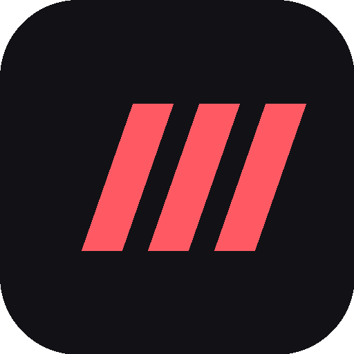
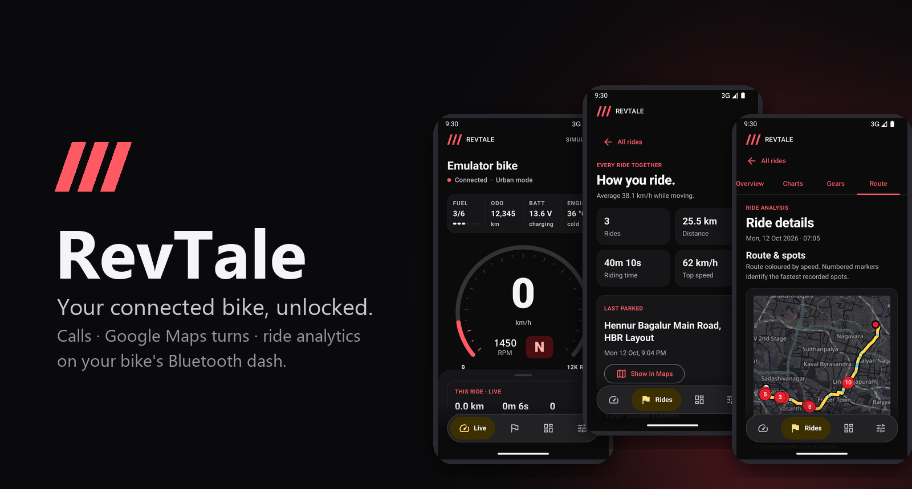
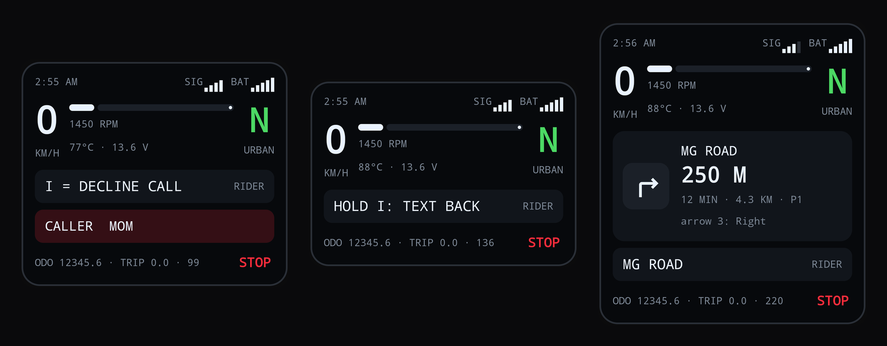
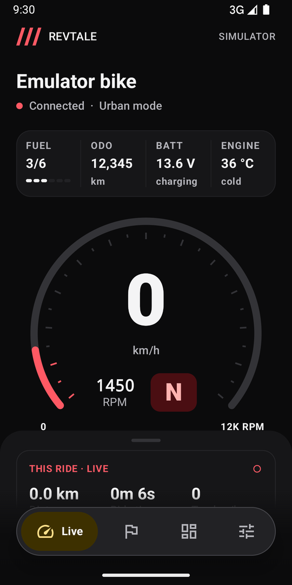
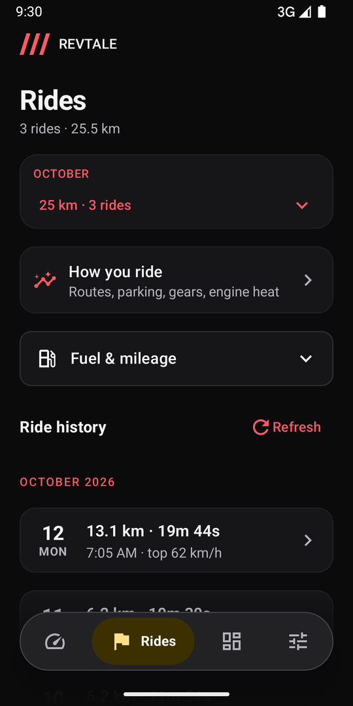
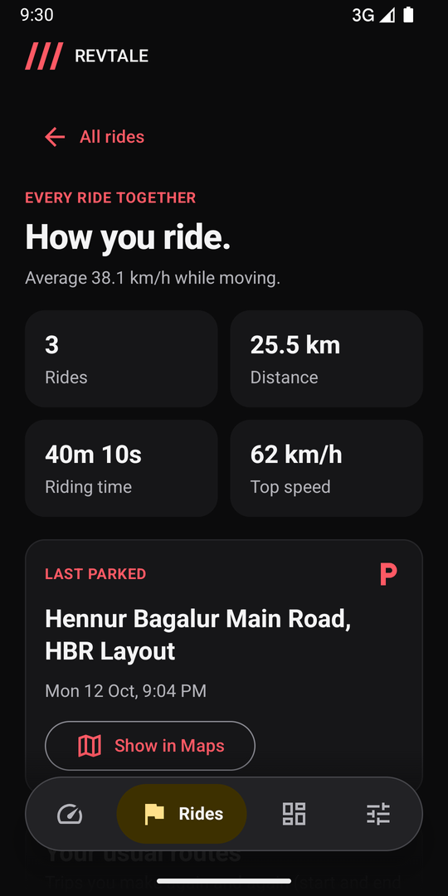
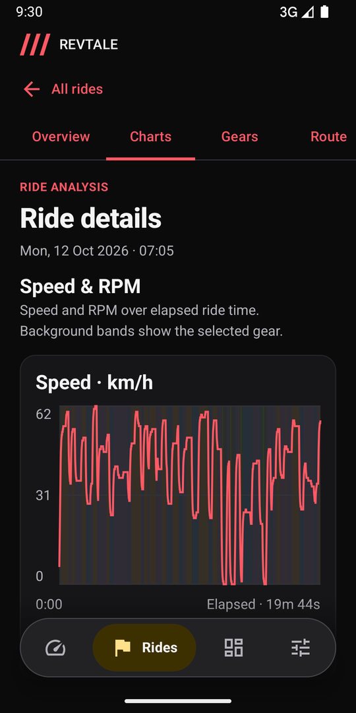
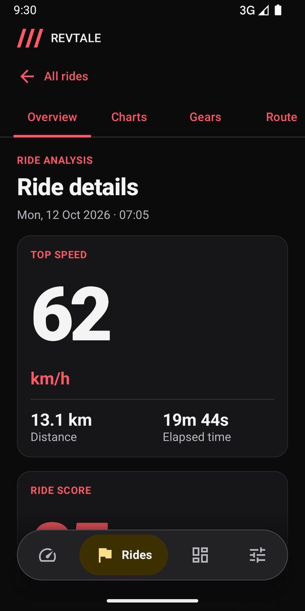
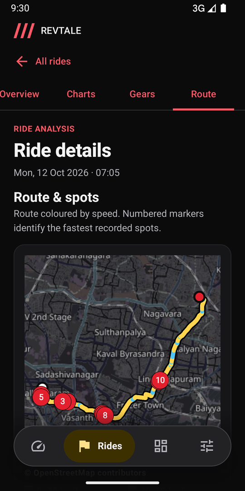
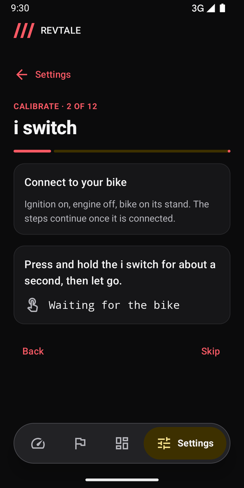

<div align="center">

<br/>



# RevTale

### Your connected bike, unlocked.

<br/>

[](https://github.com/rohit-adak/revtale/releases)
[](https://github.com/rohit-adak/revtale/releases)

[](LICENSE)

<br/>

[**Download**](#download) · [**Features**](#features) · [**Supported bikes**](#supported-bikes) · [**Privacy**](#privacy) · [**Build**](#build) · [**License**](#license) · [**Disclaimer**](#disclaimer)

</div>

> [!IMPORTANT]
> RevTale is an independent, open-source app. It is not affiliated with, endorsed by, or connected to any motorcycle maker or Google. It doesn't use any official app, server or account.

---

<div align="center">



</div>

RevTale talks to the Bluetooth dash (instrument cluster) of connected motorcycles and scooters. Your phone handles the
calls, the Google Maps turns and the ride history, and the dash shows what matters while you ride. It connects by itself
when you switch the ignition on, so you never have to open the app before a ride.

<div align="center">

<h1><a id="features"></a>Features</h1>

<table>
  <tr>
    <td width="50%" valign="top">

#### 📞 Calls on the dash
- **See who's calling**: the contact's name on the dash, even when it has an emoji in it.
- **Press `i` to decline**, then **hold `i` to text back** a message you choose.
- **Read their reply** on the dash, page by page, and dismiss it with one press.

#### 🧭 Google Maps on the dash
- **Turn-by-turn from Google Maps**: the right arrow, the distance and **the road name**.
- **ETA and traffic** on the dash when the next turn is far away.
- **One-tap Home / Office** and saved places: from search, the map, or *Share* in Google Maps. No API key.
- **Weather** at your destination before the route starts.

#### 🏍️ Your bike, live
- Speed, RPM, gear, riding mode, fuel, odometer, battery and engine temperature.
- **Last-known values** when the bike is off.
- **Overheating**: when, where, and whether it was traffic, your riding or the weather.

    </td>
    <td width="50%" valign="top">

#### 📊 Ride analytics
- **Every ride saved automatically** with speed, RPM, gear and route.
- **Charts, gear use, fastest spots** and a **ride score out of 100**.
- **Monthly report**, usual routes and how long each one really takes.
- **Fuel & mileage**: notices a fill-up, asks what you paid, and works out km/L and your fuel spend.

#### 🅿️ Parking & "who took my bike?"
- **Parking spot saved** when you switch off, with a note or photo.
- **Ridden while you were away**: how far, fuel used, top speed.

#### ✨ The rest
- **Calibrate your bike** like a TV remote: press each switch, say what the dash shows.
- **Home-screen widget** (every size) and quick-settings tile.
- **Backup & restore** in one file; **GPX export** and **shareable ride cards**.
- **No-notification mode**: Android wakes RevTale only when your bike is near.
- Dark & light themes, haptics, big-font friendly.

    </td>
  </tr>
</table>

</div>

---

<div align="center">

<h1>On your dash</h1>



<sub>The app's own virtual dash (built-in simulator): a ringing call, the text-back prompt after declining, a Google Maps turn.</sub>

</div>

---

<div align="center">

<h1>Screenshots</h1>

<table>
  <tr>
    <td></td>
    <td></td>
    <td></td>
    <td></td>
  </tr>
  <tr>
    <td align="center"><sub>Live</sub></td>
    <td align="center"><sub>Ride history</sub></td>
    <td align="center"><sub>How you ride</sub></td>
    <td align="center"><sub>Speed & RPM</sub></td>
  </tr>
  <tr>
    <td></td>
    <td></td>
    <td></td>
    <td></td>
  </tr>
  <tr>
    <td align="center"><sub>Ride details</sub></td>
    <td align="center"><sub>Route & fastest spots</sub></td>
    <td align="center"><sub>Calibrate your bike</sub></td>
    <td></td>
  </tr>
</table>

<sub>Screenshots use the built-in bike simulator and made-up rides.</sub>

</div>

---

<h1><a id="supported-bikes"></a>Supported bikes</h1>

| Bike | Status |
|---|---|
| Apache RTR 160 4V (Bluetooth / SmartXonnect dash) | ✅ Built and ride-tested on this bike |
| Other models with the same Bluetooth dash (Apache RTR 200 4V, Raider 125, NTorq 125, Jupiter SmartXonnect, …) | 🧪 Should work: run **Settings → Calibrate your bike** |

Every model reports its switches and draws its dash a little differently. **Calibrate your bike** teaches RevTale yours in
about two minutes, parked. Then **Share this bike's profile** helps add your model to this list.

<h1><a id="download"></a>Download</h1>

Grab the latest APK from **[Releases](https://github.com/rohit-adak/revtale/releases)** and install it. Your browser or
file manager will ask once to allow installing apps. RevTale checks for new releases itself and offers the update.

**Setup:**
1. Open RevTale and allow Bluetooth, location and notifications.
2. Turn the ignition on, tap **Find my bike**, and pick your bike. It never picks one for you.
3. Enter the passkey your dash shows.
4. For Google Maps turns, allow **notification access** when asked. For calls, allow phone and SMS.
5. On Samsung, set **Settings → Apps → RevTale → Battery → Unrestricted**.

<h1><a id="privacy"></a>Privacy</h1>

- Everything stays on your phone: rides, routes, parking spots, fuel log. No account, no server, no analytics.
- RevTale connects only to the bike you chose.
- The only network calls are weather (Weather Union / Open-Meteo), routes (OSRM), map tiles (OpenStreetMap) and the
  update check (GitHub). None of them get your ride history.

<h1><a id="build"></a>Build</h1>

```sh
./gradlew testDebugUnitTest assembleDebug     # JDK 17+, Android SDK 36
```

The protocol notes are in [PROTOCOL.md](PROTOCOL.md) and the code map is in [AGENTS.md](AGENTS.md). `Protocol.kt` and
`RideStats.kt` are plain Kotlin with unit tests. The built-in **bike simulator** (Settings → Developer, unlocked by
tapping the version 7 times) lets you work on everything without a bike.

**Ground rules:** RevTale sends the bike only display, info and navigation frames, never vehicle control, settings or
firmware. Nothing animates on screen or on the dash while you're moving.

<h1><a id="license"></a>License</h1>

RevTale is free software under the [GNU General Public License v3.0](LICENSE). You can use, study, change and share it.
If you share a changed version, it has to stay open source under the same license.

<h1><a id="disclaimer"></a>Disclaimer</h1>

RevTale is an independent project made by riders, for riders. "Apache", "SmartXonnect" and other names are
trademarks of their owners and are used here only to describe which bikes the app works with. The protocol was worked
out from the bike's own Bluetooth traffic. This repository contains no vendor app, code, logos or artwork. Ride
attentively: glance at the dash, not the phone.
